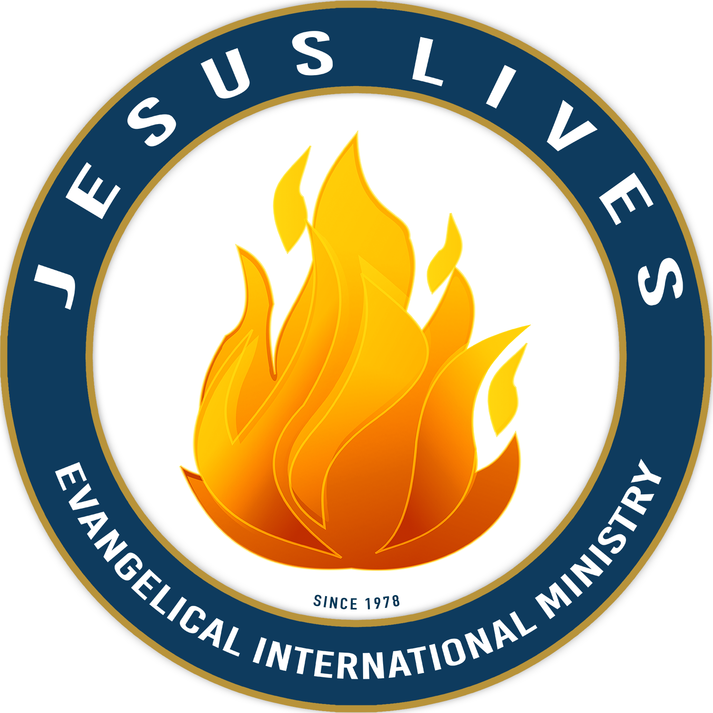
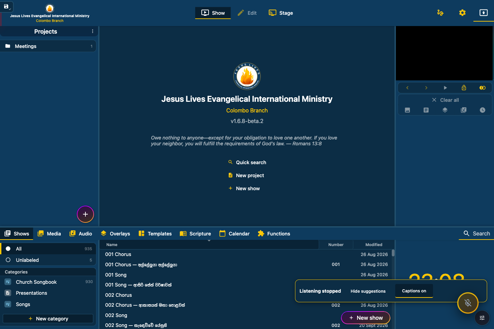
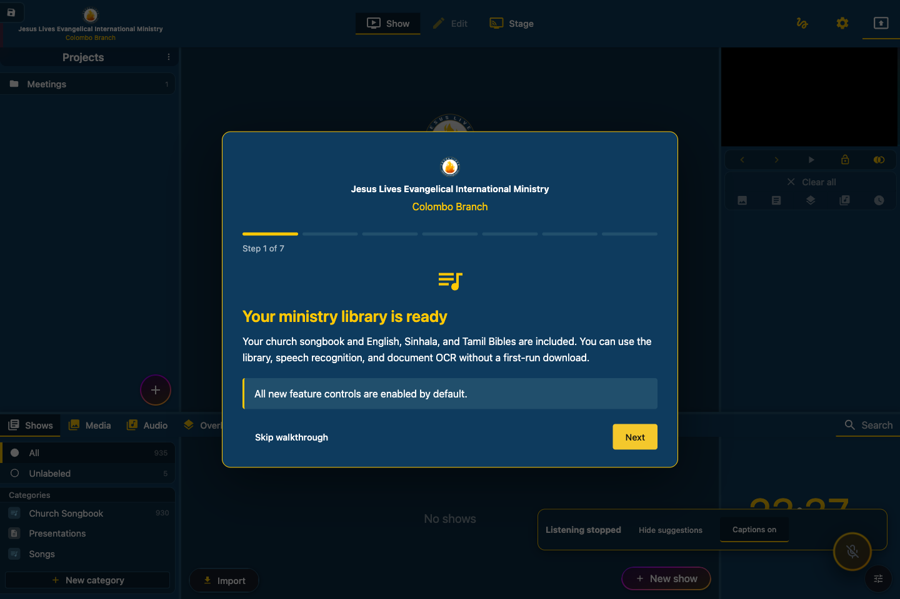

<p align="center">
  
</p>

<h1 align="center">Jesus Lives Ministry</h1>
<p align="center"><strong>Jesus Lives Evangelical International Ministry</strong></p>
<p align="center">Songs, Scripture, subtitles, and live presentation assistance for your ministry branch.</p>

## What is included

- **Your church library, ready offline:** 930 songs and choruses, five saved Scripture presentations, and English, Sinhala, and Tamil Bibles.
- **Independent layouts:** separate fonts, text positions, colours, and backgrounds for song lyrics and Bible verses.
- **Live Bible search:** type a reference such as `Psalms 3:4`, a range, a book name, or words from a verse. Review results before projecting.
- **Songbook and Bible imports:** PDF, Word, CSV, and supported app exports, with local OCR for scanned pages, correction previews, duplicate handling, cancellation, and undo.
- **Local speech recognition:** a bundled multilingual Whisper model with automatic language detection. English, Sinhala, and Tamil OCR recognition data is also included.
- **Live suggestions and subtitles:** recognize song titles, lyrics, Bible references, and verse text using the local library first.
- **Confirm once, then follow:** accept a song or passage to follow its slides automatically. Manual navigation pauses following; Pause, Resume, Stop, and output locks remain available.
- **Branch identity:** the ministry logo, full ministry name, and your branch name appear in the main window, using the logo's navy and gold palette.

The new feature controls, suggestions, and captions are **enabled by default**. Microphone capture starts when you choose **Start listening**. Existing explicit preferences are preserved.

## First launch

1. Enter your branch name, choose the interface language and clock format, and confirm the library location.
2. Follow the seven-step walkthrough, or skip it and replay it later through Help.
3. Open **Shows** for songs or **Scripture** for the trilingual Bible collection.
4. Check your preview and presentation output before projecting.
5. For live assistance, start listening and accept a suggestion to begin following.

Change the branch name later in **Settings → General**. Adjust song and Bible layouts in **Settings → Styles**, and recognition, caption, and following options in **Settings → Smart**.

## Screenshots

These screenshots show the current application with a temporary Colombo example profile.





[View all six current screenshots](docs/screenshots/README.md), including branch setup, Follow Live, Bible search, and independent layouts.

## Offline use and installer status

Download available packages from [GitHub Releases](https://github.com/jerrick-godwin/FreeShow-JLM/releases). See each release for platform validation and known limitations.

The installers are configured to include the church library, three Bibles, speech model, and English/Sinhala/Tamil OCR data. The offline payload is approximately **401 MiB before compression**; installed copies use local resources without a first-run download. Existing library records are preserved during setup and upgrades.

**v1.0.0 is unsigned and is not a trusted production release.** macOS may refuse to open it. Signed replacement installers are blocked until ministry signing credentials are configured. Native Windows x64, Intel Mac, and Apple Silicon Mac packaging and payload checks passed; clean-machine acceptance still needs validation.

Stable publishing now requires valid Windows signatures and Mac Developer ID signatures, notarization, stapled tickets, and Gatekeeper acceptance. Unsigned development builds remain available for testing, but the publisher rejects them. See the [signing setup and release checklist](docs/RELEASE_SIGNING.md).

Online song discovery requires an internet connection. Review sources and provide lyrics you have permission to use before adding them to the library. Optional alternative recognition and chat models are separate from the bundled default model.

Live following is experimental. Recognition during singing, accompaniment, congregation noise, and representative Sinhala/Tamil recordings still needs real-world validation. Uncertain recognition holds the current display; switching to a different song or passage requires confirmation.

## Run from source

Use **Node.js 22.12 or newer** and the native build tools required by Electron dependencies: Xcode Command Line Tools on macOS, or Visual Studio's Desktop development with C++ tools on Windows. Native dependencies may also require Python and platform-specific libraries.

```sh
npm ci --include=optional
npm run prepare:bundled
npm start
```

Dependency installation and initial asset preparation require internet access. Bundled assets are checked against their recorded sizes and SHA-256 checksums.

Build the application with:

```sh
npm run build
```

See [installer delivery](docs/installer-delivery.md) for packaging, supported targets, and distribution limitations. Upstream automatic updates are disabled so they cannot replace this ministry edition with a different build.

## Validation and documentation

The latest delivery passed **230 unit tests** (10 optional integration tests skipped), three packaging safeguard tests, the desktop presentation flow, and the Apple Silicon Mac package checks. The existing Svelte checking backlog remains at 194 errors and 60 warnings.

- [First launch and feature defaults](docs/first-launch.md)
- [Live speech, captions, and following](docs/live-assistance.md)
- [Offline library and recognition assets](docs/offline-bundle.md)
- [Layouts, Bible search, and imports](docs/presentation-features.md)
- [Ministry branding](docs/ministry-branding.md)

Report problems or request improvements through this repository's [issues](https://github.com/jerrick-godwin/FreeShow-JLM/issues).

## License and acknowledgements

This ministry edition builds on the [ChurchApps upstream presentation project](https://github.com/ChurchApps/FreeShow) and is distributed under [GPL-3.0](LICENSE). Original copyright and license notices are retained. Bundled models, OCR data, and Bible texts have their own notices in [resources/bundled/licenses](resources/bundled/licenses).
